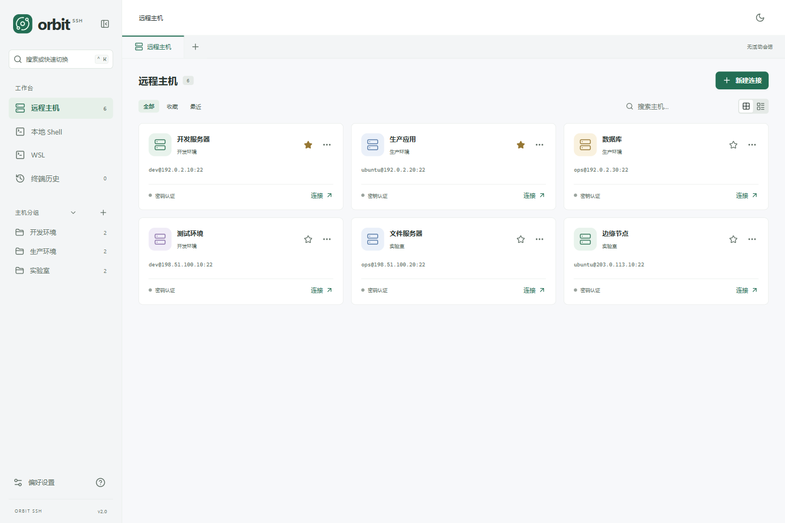
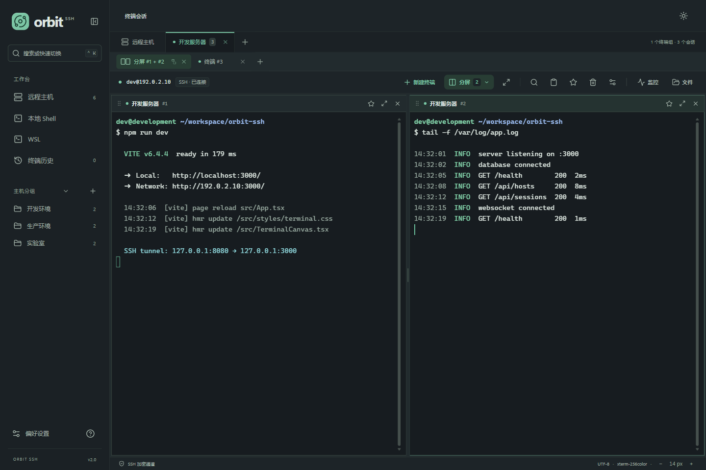
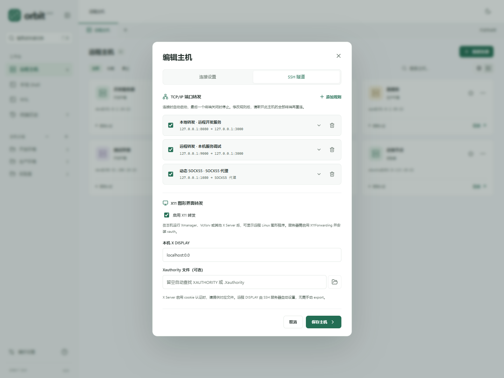
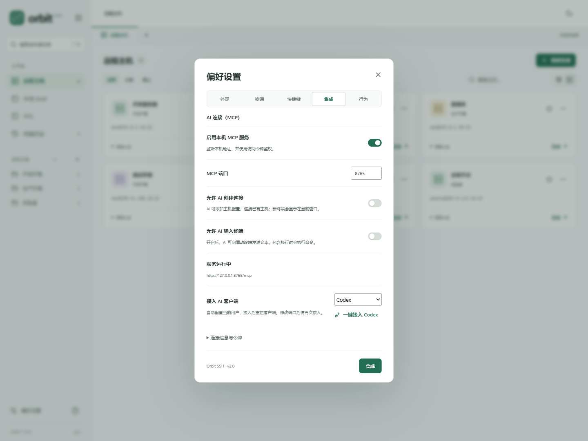
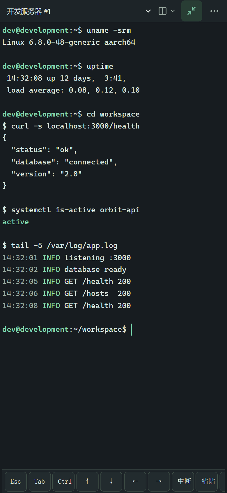

# Orbit SSH

把服务器终端、文件和监控放在同一个窗口。

Orbit SSH 是一款面向 Windows 和 Android 的个人 SSH 工具，适合日常连接 Linux 服务器、维护文件、配置 SSH 隧道，以及在 Windows 上使用本地 Shell 和 WSL。无需注册账号，主机配置和登录凭据保存在当前设备。

**v2.0：[Windows x64 · 安装版](https://github.com/xmyhhh/orbit-ssh/releases/download/v2.0/OrbitSSH-v2.0-windows-x64-setup.exe) · [便携版](https://github.com/xmyhhh/orbit-ssh/releases/download/v2.0/OrbitSSH-v2.0-windows-x64-portable.zip) · [Android ARM64 · APK](https://github.com/xmyhhh/orbit-ssh/releases/download/v2.0/OrbitSSH-v2.0-android-arm64.apk)** · [发布说明](https://github.com/xmyhhh/orbit-ssh/releases/tag/v2.0) · [反馈问题](https://github.com/xmyhhh/orbit-ssh/issues)



<details>
<summary>查看更多 v2.0 界面：分屏终端、SSH 隧道、AI 集成与 Android</summary>

### 分屏终端与工作区

拖动标签即可组合分屏，每组最多 4 个窗格；不同分屏标签分别保留布局和会话。



### SSH 隧道与 X11

在主机设置中管理本地、远程和动态 SOCKS5 转发，并配置远程图形程序的 X11 转发。



### 连接 AI 工具

在 Windows 偏好设置中启用 MCP，一键接入六种客户端，分别控制连接创建与终端输入权限。



### Android 终端

手机上保留主机管理、SSH / SFTP 和文件编辑，提供终端全屏、辅助按键、长按选择和双指缩放。



</details>

*截图基于 v2.0 界面，使用示例主机和模拟输出；Android 图为手机尺寸的界面预览。*

## 下载与运行

| 平台 | 下载 | 运行要求 |
| --- | --- | --- |
| Windows x64 · 安装版 | [OrbitSSH-v2.0-windows-x64-setup.exe](https://github.com/xmyhhh/orbit-ssh/releases/download/v2.0/OrbitSSH-v2.0-windows-x64-setup.exe) | 双击安装；重复安装会覆盖旧版本并保留配置。 |
| Windows x64 · 便携版 | [OrbitSSH-v2.0-windows-x64-portable.zip](https://github.com/xmyhhh/orbit-ssh/releases/download/v2.0/OrbitSSH-v2.0-windows-x64-portable.zip) | 解压后运行 `OrbitSSH.exe`，无需安装。 |
| Android ARM64 | [OrbitSSH-v2.0-android-arm64.apk](https://github.com/xmyhhh/orbit-ssh/releases/download/v2.0/OrbitSSH-v2.0-android-arm64.apk) | Android 9+；将 APK 传到手机，按系统提示允许安装。 |

所有安装包均包含界面和 SSH 引擎，无需安装 Go 或 Node.js。启动后进入「远程主机」，点击「新建连接」添加服务器。可用发布页的 [SHA256SUMS.txt](https://github.com/xmyhhh/orbit-ssh/releases/download/v2.0/SHA256SUMS.txt) 核对下载文件。

Windows 安装版会把程序安装到当前用户目录（默认 `%LOCALAPPDATA%\Programs\Orbit SSH`），卸载入口在 Windows 设置或开始菜单中；主机配置、凭据和终端历史保存在 `%APPDATA%\OrbitSSH`，覆盖安装和卸载都不会删除。安装版会检测并安装 Microsoft Edge WebView2 Runtime；便携版需要系统已有 WebView2，Windows 11 通常已自带。如果无法启动或提示缺少 WebView2，请从 [微软官方网站](https://developer.microsoft.com/microsoft-edge/webview2/#download) 安装 Evergreen Runtime 后重试。WSL 是可选功能，使用时需另外安装 WSL 和 Linux 发行版。

Android 安装、文件导入导出、软键盘和本地构建见 [Android 说明](docs/ANDROID.md)。手机端主要面向前台使用，系统回收应用会结束会话和传输。Windows 本地 Shell、WSL、托盘和 MCP 集成用于桌面端。

## 你可以用它做什么

| 功能 | 使用方式 |
| --- | --- |
| 管理服务器 | 按分组整理主机，收藏常用服务器，搜索名称或地址，查看最近连接；卡片和列表视图随时切换并记住选择。 |
| 连接 SSH | 使用密码、SSH Agent 或 PEM / OpenSSH 私钥登录，可记住密码和私钥口令；支持多级跳板机（最多 5 级），首次连接核对服务器指纹。 |
| 导入 SSH 配置 | 读取 `~/.ssh/config` 中的主机、端口、用户、私钥和 ProxyJump，选择要导入的条目并自动关联跳板机。 |
| 备份主机配置 | 将主机导出为不含密码和密钥的 JSON，或从导出的文件合并导入，按主机 ID 或名称更新而不重复创建。 |
| 生成密钥 | 在新建主机时生成 Ed25519 密钥对，私钥保存在应用数据目录的 `keys/` 中，同名文件不会被覆盖。 |
| 分屏与多终端 | 同一主机可开多个终端，拖动标签组合分屏，每组最多 4 个窗格；切换标签保留各组布局和会话。双击标签或点击终端工具栏的铅笔可重命名会话。 |
| 使用终端 | 搜索输出、复制粘贴、调整字号，右键打开常用操作；多行粘贴前会确认。 |
| 查看终端历史 | 在当前设备保存输出、检索历史、重命名和加入精选，可在偏好设置中调整保存数量或关闭记录。 |
| 配置 SSH 隧道 | 为主机保存本地、远程及动态 SOCKS5 TCP 转发规则，连接时启动，最后一个终端关闭时释放。 |
| 转发 X11 | 通过 SSH 在本机 X Server 中显示远程 Linux 图形程序，支持 Xauthority cookie 认证。 |
| 传输文件 | 双栏浏览本地与远程目录，上传、下载文件或整个文件夹，查看进度、速度和失败原因。 |
| 管理远程文件 | 右键远程文件或文件夹可重命名、修改八进制权限或删除；删除文件夹前必须为空。 |
| 编辑远程文本 | 直接打开配置或代码，使用语法高亮、查找替换、撤销和自动换行，保存到服务器。 |
| 查看服务器状态 | 查看 Linux 服务器的 CPU、内存、交换空间、磁盘、网络速率、磁盘 I/O、温度和前 500 个进程，可调整刷新间隔或暂停采样；可向进程发送 TERM、KILL、HUP 等信号。 |
| 打开 WSL | 自动发现本机已安装的发行版，直接打开交互终端，同一发行版可开多个会话。 |
| 打开本地 Shell | 在窗口中运行 Windows PowerShell、CMD 或已安装的 PowerShell 7，支持多个独立终端。 |
| 常驻后台 | Windows 启动后显示系统托盘图标，默认关闭窗口时保留终端和传输；从托盘菜单恢复窗口或退出应用。 |
| 连接 AI 工具 | 通过本机 MCP 让 AI 查看终端和历史，也可授权 AI 配置主机、创建连接并操作同一个终端；连接创建和终端输入默认关闭。 |
| 调整外观 | 浅色、深色或跟随系统，在偏好设置中调整终端字号和行距。 |

## 分屏终端与历史

拖动一个终端标签到另一个终端的边缘，即可合并为分屏标签；也可以使用「终端布局」选择窗格。每组最多 4 个终端，拖动分隔线调整比例，切换到其他标签再回来会恢复该组布局。不同分屏组合互不影响。

「解除分屏」恢复独立标签，窗格上的「收起」把该终端移回独立标签，均保留连接。关闭分屏标签会结束组内全部终端。手机上用标签左侧的拖动柄调整分屏；点击全屏按钮后，可通过顶部下拉框切换终端。操作细节见[终端工作区说明](docs/TERMINAL-WORKSPACES.md)。

「终端历史」保存当前设备上的终端输出，支持搜索、重命名、精选和删除。偏好设置可关闭自动记录或调整保留数量；活动会话的输出搜索不受历史记录开关影响。会话名称会同时显示在终端标签、分屏标题、工作流目标、终端历史和 MCP 的 `list_sessions` 结果中。

## 连接 AI 工具（MCP）

打开「偏好设置 → 集成」，启用本机 MCP 服务。Orbit SSH 会在 `127.0.0.1` 上启动 Streamable HTTP MCP 端点，默认地址为 `http://127.0.0.1:8765/mcp`；端口可在同一页面修改。选择 Codex、Claude Code、Cursor、OpenCode、Gemini CLI 或 VS Code Copilot，点击「一键接入」即可自动添加或更新当前用户的配置，接入后重启对应客户端。修改端口后，再次接入以更新连接地址。

已有配置会先备份到同一目录，只更新 Orbit SSH 的条目，保留其他设置、MCP 服务和 JSONC 注释。重复接入不会添加重复条目，配置已是最新时不会重复写入或生成备份。配置格式有误时会保留原文件并报错。

| 客户端 / `--target` | 当前用户配置（`global`） | 当前项目配置（`local`） |
| --- | --- | --- |
| Codex / `codex` | `~/.codex/config.toml`；优先使用 `CODEX_HOME` | `.codex/config.toml` |
| Claude Code / `claude` | `~/.claude.json`；设置 `CLAUDE_CONFIG_DIR` 时使用该目录内的 `.claude.json` | `.mcp.json` |
| Cursor / `cursor` | `~/.cursor/mcp.json` | `.cursor/mcp.json` |
| OpenCode / `opencode` | `~/.config/opencode/opencode.json` 或已有的 `opencode.jsonc` | `opencode.json` 或已有的 `opencode.jsonc` |
| Gemini CLI / `gemini` | `~/.gemini/settings.json` | `.gemini/settings.json` |
| VS Code Copilot / `vscode` | 默认用户配置目录的 `Code/User/mcp.json`；Windows 为 `%APPDATA%\Code\User\mcp.json` | `.vscode/mcp.json` |

`~` 表示用户主目录。OpenCode 遵循 `OPENCODE_CONFIG`、`OPENCODE_CONFIG_DIR` 和 `XDG_CONFIG_HOME`，同一目录中 JSON 与 JSONC 均存在时更新后加载的 JSONC 文件。VS Code 使用默认用户配置文件；自定义配置文件可使用下方的手动复制功能。

也可在命令行完成同样的接入：

```powershell
.\OrbitSSH-v2.0-windows-x64.exe install --target=codex --location=global --yes
.\OrbitSSH-v2.0-windows-x64.exe install --target=opencode --location=global --yes
# 同时接入多个客户端，也可使用 --target=all 接入上述全部客户端
.\OrbitSSH-v2.0-windows-x64.exe install --target=codex,claude,cursor,opencode --yes
```

`--yes` 跳过交互确认，省略时会列出目标文件并询问是否继续；默认 `--target=codex --location=global`。`--location=local` 写入上表中的当前项目配置，可能需要客户端的项目信任或 MCP 授权。多客户端接入时会继续处理其他客户端，任一失败则返回非零退出码。命令仅注册连接信息，运行 MCP 服务仍需在 Orbit SSH 中启用并保持应用运行。

手动接入时，先选择客户端，再展开「连接信息与令牌」，复制对应的 TOML 或 JSON 并合并到配置中。生成的内容会使用各客户端要求的 HTTP 连接格式，包括 OpenCode 的 `mcp`、Gemini 的 `httpUrl` 和 VS Code 的 `servers`。配置包含本机访问令牌，请勿公开分享或提交到版本控制。客户端连接后会自动发现 Orbit SSH 的 MCP 工具，不需要安装额外插件或技能。若连接失败，先确认 Orbit SSH 的 MCP 状态显示「服务运行中」，并检查配置中的地址和令牌与应用中显示的一致。

MCP 提供以下工具：

| 工具 | 功能 |
| --- | --- |
| `list_hosts` | 列出已保存的 SSH 主机配置，不返回密码、私钥内容或口令。 |
| `create_host` | 添加并保存主机配置，支持名称、地址、端口、用户名、密码或私钥认证以及分组。 |
| `connect_host` | 为已保存主机打开新的 SSH 终端，返回 `sessionId`；可通过 `name` 为新终端命名。 |
| `list_sessions` | 列出当前活动的 SSH、本地 Shell 和 WSL 终端及其自定义名称。 |
| `rename_session` | 重命名活动终端；名称会同步到标签、分屏标题和终端历史。传空名称可恢复默认名称。 |
| `read_terminal` | 读取活动终端最近的输出。 |
| `search_terminal_history` | 搜索本机保存的终端历史。 |
| `send_terminal_input` | 向活动终端发送文本；包含换行时会执行命令。 |
| `list_directory` | 列出远程目录内容。需要「允许 AI 访问文件」。 |
| `read_file` | 读取远程文本文件（最多 512 KB），二进制内容以 base64 返回。 |
| `write_file` | 覆盖写入远程文本文件；需要同时开启文件访问和终端输入权限。 |
| `get_metrics` | 读取 CPU、内存、磁盘、网络速率、磁盘 I/O、温度和进程列表。 |
| `kill_process` | 向指定 PID 发送 TERM、KILL、HUP 等信号；需要「允许 AI 输入终端」。 |
| `run_command` | 提交一条命令，在 Orbit SSH 窗口中等待你确认后才写入终端。 |

`create_host` 和 `connect_host` 需要开启「允许 AI 创建连接」；`send_terminal_input`、`kill_process` 和 `run_command` 需要另外开启「允许 AI 输入终端」；`list_directory` 和 `read_file` 需要开启「允许 AI 访问文件」。三个权限相互独立，默认关闭。`write_file` 同时需要文件访问和终端输入权限。AI 创建的终端与手动打开的终端相同，你可以直接查看输出、继续输入或关闭连接。

已有主机时，AI 先调用 `list_hosts` 获取主机 ID，再调用 `connect_host`。没有主机时，先调用 `create_host`，填写 `address`、`username` 及可选的 `name`、`port`、`auth_type`、`key_path`、`jump_host_id`、`group`，然后使用返回的主机 ID 建立连接。`auth_type` 支持 `password`、`key` 和 `agent`；默认端口为 22，提供 `key_path` 时默认使用私钥认证，否则使用密码认证；`jump_host_id` 指向另一台已保存的主机。`create_host` 只添加配置，不覆盖已有主机。`connect_host` 和 `rename_session` 都接受最多 80 个字符的终端名称；留空或传入空名称会恢复为默认的主机或 Shell 名称。终端名称也会出现在终端历史和 `list_sessions` 中。

连接可复用本机已保存的密码或私钥口令，也可以向 `connect_host` 提供仅本次使用的 `password` 或 `passphrase`；这些凭据不会写入主机配置、工具结果或前端事件。首次连接返回 `HOST_KEY_UNKNOWN` 时，需要核对返回的 SHA-256 指纹，再通过 `accepted_fingerprint` 重试；已保存指纹发生变化时仍拒绝连接。Orbit SSH 界面需保持运行；关闭正在创建的终端或取消 MCP 请求会取消连接。

连接后可以直接在 Codex 中提出自然语言请求，例如：

> 使用 Orbit SSH MCP 列出当前会话，读取会话 `<session_id>` 最近的终端输出，并搜索历史中与 `connection refused` 有关的记录。只读，不要向终端发送输入。

允许创建连接后，也可以提出：

> 使用 Orbit SSH MCP 找到已保存的「开发服务器」，为它打开一个新终端，然后读取输出。

> 使用 Orbit SSH MCP 添加主机「测试机」，地址为 192.0.2.10，端口 22，用户名 ubuntu，使用本机 C:/Users/me/.ssh/id_ed25519 私钥。保存后连接，并把新终端显示在 Orbit SSH 中。

要执行命令时，先在 Orbit SSH 中启用「允许 AI 输入终端」，再明确要求 Codex 调用 `send_terminal_input` 或 `run_command`。`run_command` 会先在窗口中显示完整命令，你确认后才会发送；包含 `rm -rf /`、`mkfs`、`shutdown` 等高风险内容时会显示更强的警告。发送内容包含换行时会执行命令；可以在提示中要求它先说明命令并等待你确认。

服务只接受本机连接，并要求访问令牌。历史搜索只包含已保存的记录，活动终端读取不受历史记录开关影响；历史记录副本保存在 Orbit SSH 配置目录的 `terminal-history` 子目录。通过设置关闭 MCP 服务会停止监听，并关闭连接创建、终端输入和文件访问权限。

## 第一次连接服务器

1. 点击「新建连接」，填写主机名称、IP 地址或域名、SSH 端口和用户名。地址不需要加 `ssh://`，默认端口为 `22`。
2. 选择密码或私钥认证。使用私钥时，选择本机的私钥文件；加密私钥会在连接时要求输入口令。
3. 保存后双击主机卡片或点击「连接」。首次连接会显示服务器的 SHA-256 指纹，请与可信来源提供的指纹核对后再确认。
4. 如需下次免输密码，可勾选「记住密码」。只有成功登录后，凭据才会保存到当前设备的凭据库：Windows 使用凭据管理器，Android 使用 Keystore 加密保存。

已经连接的主机再次双击，会新建一个独立终端。也可以在当前主机内点击「新建终端」或标签旁的「＋」。关闭一个终端不会关闭其他终端；关闭主机标签会结束该主机下的全部会话。

### SSH Agent 与跳板机

认证方式选择「SSH Agent」时，Orbit SSH 使用本机 Agent 中已加载的密钥。Windows 需先启动系统服务 `OpenSSH Authentication Agent`（`Get-Service ssh-agent`），再用 `ssh-add` 加载密钥；Linux 和 macOS 读取 `SSH_AUTH_SOCK`。

在主机设置中选择「跳板机」即可通过另一台已保存的主机转发连接，支持最多 5 级，并会拒绝循环引用。跳板机的服务器指纹必须先前直连一次并确认；目标主机的「信任并连接」不会代为信任跳板机。密码或私钥认证的跳板机会在连接对话框中单独要求凭据，也可以使用跳板机自己保存的密码或口令。

### 导入和导出主机

「导入 SSH 配置」会解析 `~/.ssh/config` 中的 `Host`、`HostName`、`User`、`Port`、`IdentityFile` 和 `ProxyJump`，跳过通配符和 `Match` 规则。同名主机会更新而不是重复创建，导入完成后自动关联跳板机。

「导出」生成只包含主机配置的 JSON，不包含密码、私钥内容或已信任指纹。在另一台设备上使用「导入」合并，按主机 ID 或名称匹配；跳板机引用会在导入后重新关联。新建私钥主机时可以生成 Ed25519 密钥对，私钥位于应用数据目录的 `keys/`，同名文件不会被覆盖。

## SSH 隧道与 X11 转发

新建或编辑主机时，切换到「SSH 隧道」页添加规则，保存后重新连接即可自动启动。支持以下三种 TCP 转发：

| 类型 | 示例 | 用途 |
| --- | --- | --- |
| 本地转发 | 本机 `127.0.0.1:8080` → 服务器侧 `127.0.0.1:3000` | 在本机浏览器访问远程开发服务、数据库等。 |
| 远程转发 | 服务器 `127.0.0.1:9000` → 本机侧 `127.0.0.1:3000` | 让服务器访问本机服务。 |
| 动态 SOCKS5 | 本机 `127.0.0.1:1080` | 将应用的 SOCKS5 代理设为此地址，经服务器访问目标；支持 TCP，域名由服务器解析。 |

规则可单独启用、停用、编辑和删除。默认只监听 `127.0.0.1`；改为 `0.0.0.0` 或 `::` 会监听所有网卡。远程监听需要服务器允许 TCP 转发，对外开放还受 `GatewayPorts` 设置限制。监听端口被占用或服务器拒绝规则时会明确提示，并回收本次启动的规则。

同一主机的多个 SSH 终端共享一组转发规则。关闭其中一个终端不会中断转发，关闭最后一个终端或退出应用会停止监听和活动转发。修改规则后需断开该主机的全部终端再重连。

需要显示远程 Linux 图形程序时，在同一页开启「X11 转发」。先启动本机的 Xmanager、VcXsrv 等 X Server，填写它的 DISPLAY（Windows 通常为 `localhost:0.0`）；服务器需启用 `X11Forwarding yes` 并安装 `xauth`。连接后可运行 `xclock` 等图形程序，远程 `DISPLAY` 由 SSH 服务器自动设置。

X Server 使用 cookie 认证时可选择对应的 Xauthority 文件；留空会查找 `XAUTHORITY` 环境变量和用户目录的 `.Xauthority`。认证 cookie 仅保存在内存中，远端使用每次连接随机生成的 cookie，应用验证后在本机替换为 X Server 的 cookie。Orbit SSH 不自带 X Server。

## 文件传输与编辑

连接服务器后，点击「文件」打开双栏文件管理器：**左侧是本地，右侧是远程**。

- **上传**：在左侧选择文件或文件夹，切换右侧到目标目录，再点击「上传」。
- **下载**：在右侧选择项目，切换左侧到保存目录，再点击「下载」。
- **同名文件**：默认跳过，可按需要切换为替换。
- **编辑远程文件**：双击远程文本文件，或右键选择「编辑」；修改后按 `Ctrl + S` 保存。本地文本支持只读预览。

传输队列会显示进度、速度和错误，可取消任务。切换终端或主机标签时，传输继续进行；关闭所属连接或退出应用会中断传输。未保存的文本在关闭时会提醒，保存失败会保留当前修改。

远程文本编辑支持不超过 **2 MB 的 UTF-8 文件**，覆盖常见脚本、配置和代码的语法高亮。文件传输需要服务器启用 SFTP；目前不支持断点续传，符号链接和特殊文件会跳过。

## 在窗口中使用本地 Shell

从左侧点击「本地 Shell」，右侧会以卡片或列表展示检测到的 **Windows PowerShell**、**CMD** 和 **PowerShell 7**。点击对应项目即可打开交互终端，无需添加主机或配置 SSH。卡片和列表的切换方式与「远程主机」相同，并会记住选择；安装新的 PowerShell 7 后，可在页面中点击「刷新」重新检测。

终端默认从当前 Windows 用户的主目录启动。点击「新建终端」、会话标签旁的「＋」，或按 `Ctrl + Shift + T`，会打开相同 Shell 的独立会话。输入 `exit` 结束当前终端后，可点击「重新打开」。关闭一个终端不会影响其他会话。

本地 Shell 需要 Windows 10 1809 或更新版本，支持中文输入输出、复制粘贴、输出搜索和字号调整。文件管理与服务器监控用于 SSH 连接。

## 在窗口中使用 WSL

从左侧点击「WSL」，右侧会以卡片或列表展示已安装的 Linux 发行版及运行状态，与「本地 Shell」使用相同的布局切换方式。点击对应项目即可进入终端，无需为发行版配置 SSH 服务或密码；已有终端会继续保留，可再次点击新建独立会话。

如果列表为空，请先在 PowerShell 中运行 `wsl --install`，按照系统提示安装发行版，再回到应用刷新。WSL 内嵌终端需要 Windows 10 1809 或更新版本，以及可正常运行的 WSL 环境。

每个 WSL 终端独立运行，关闭标签只结束当前会话，不会关闭整个发行版。WSL 提供终端功能；文件管理和服务器监控用于 SSH 连接。

## 关闭窗口与后台常驻

Windows 版启动后会在系统托盘显示 Orbit SSH 图标，图标可能收纳在任务栏右侧的「^」中。默认点击窗口关闭按钮或按 `Alt + F4` 时，窗口会隐藏到托盘，SSH、本地 Shell、WSL 会话和文件传输继续运行，未保存的编辑内容也会保留。

点击托盘图标即可恢复窗口；右键菜单提供「打开 Orbit SSH」「隐藏到托盘」和「退出 Orbit SSH」。要完全退出，请选择托盘菜单中的「退出 Orbit SSH」；存在活动会话或未保存文件时，仍会按原有设置确认，取消后可以继续使用。

如果希望关闭窗口时直接退出，在「偏好设置」中关闭「关闭窗口后常驻后台」。退出应用会结束会话和传输；此设置会保存在本机。后台常驻目前用于 Windows 版。

## 常用快捷键

以下快捷键适用于 Windows。终端相关操作需要先激活终端。

| 快捷键 | 操作 |
| --- | --- |
| `Ctrl + K` | 搜索或快速切换主机 |
| `Ctrl + T` | 新建主机连接 |
| `Ctrl + Shift + T` | 为当前主机、本地 Shell 或 WSL 发行版新建终端 |
| `Ctrl + Shift + F` | 搜索终端输出 |
| `Ctrl + C` | 有选中文本时复制；无选中时向终端发送中断 |
| `Ctrl + V` | 粘贴剪贴板内容，多行文本会先确认 |
| `Ctrl + Shift + C` / `Ctrl + Shift + V` | 复制 / 粘贴 |
| `Ctrl + Shift + A` | 全选终端文本 |
| `Ctrl + +` / `Ctrl + -` | 放大 / 缩小终端字号 |
| `Ctrl + 0` | 恢复偏好设置中的字号 |
| `Ctrl + 滚轮` | 调整终端字号 |
| `Ctrl + S` | 保存正在编辑的远程文本 |
| `Shift + F10` | 打开终端或文件的上下文菜单 |

终端右键菜单还提供复制全部、查找和清屏操作。

## 配置与凭据保存在哪里

Orbit SSH 无需账号，不提供云同步或联网激活。SSH / SFTP 连接直接访问你添加的服务器。

- **主机与偏好设置**：Windows 保存在 `%APPDATA%\OrbitSSH\workspace.json`，Android 保存在应用私有目录，包含主机信息、分组、隧道规则、主题和已信任的服务器指纹。
- **密码与私钥口令**：Windows 使用凭据管理器，Android 使用 Keystore 加密保存，均不写入配置 JSON。系统凭据库不可用时会提示，不会改为明文保存。
- **私钥**：Windows 保留在原始文件位置，Android 导入到应用私有目录，配置中仅记录路径。
- **终端历史**：保存在配置目录的 `terminal-history` 子目录，可在应用中查看和删除。Windows 与 Android 的配置、凭据和历史分别保存。

备份时，请先退出应用，再复制配置文件。配置备份包含服务器地址和用户名，请妥善保管。密码和私钥口令不会随该文件迁移，私钥也需要单独备份。

Windows 更新时退出旧版后运行新版即可沿用本机配置，删除 EXE 不会清除配置或凭据；建议更新前备份。Android 使用相同签名的 APK 覆盖安装可保留配置，卸载会删除应用数据；重要文件请先导出。如需清除已保存的密码或私钥口令，可在主机编辑窗口操作。

## 常见问题

### 连接失败怎么办？

核对服务器地址、端口、用户名和认证方式，确认服务器已启用 SSH，且当前网络和防火墙允许访问该端口。私钥认证还需要确认选择的是私钥文件，服务器已配置对应公钥。

### 为什么提示服务器指纹变化？

应用保存的指纹与服务器当前指纹不一致时，会拒绝连接。重装服务器或更换 SSH 主机密钥可能导致变化，也可能是连接到了不同的机器。请先通过可信渠道核实原因和新指纹，不要直接忽略提示。反馈问题时无需提供密码或私钥。

### 为什么文件无法上传或保存？

先确认服务器已启用 SFTP，并且当前用户对目标目录有写入和重命名权限。远程编辑通过临时文件写入后替换原文件，因此仅有原文件的写权限可能不够；目前不提供 sudo 保存。

远程编辑会检测文件变化，但仍建议避免多个程序同时修改同一文件。替换保存不复制原文件的 ACL、扩展属性及硬链接关系，编辑带有特殊元数据的文件前请自行备份。

### 为什么监控没有数据？

监控目前面向 Linux 服务器，需要 `/proc`、`df` 和 procps 提供的 `ps` 命令。CPU 使用率会在第二次采样后显示；进程 CPU 是 `ps` 报告的生命周期平均值，多核时可能超过 100%。监控不需要在服务器安装 Orbit SSH 专用程序，窗口隐藏时会暂停采样。

### v2.0 支持哪些系统和架构？

本次 Release 提供 Windows x64 EXE 和 Android 9+ ARM64 APK。暂未提供 Windows ARM64、Android x86、macOS 或 Linux 安装包；其他桌面平台需要在相应系统自行构建和验证，参见[开发与构建说明](docs/DEVELOPMENT.md)。

## 反馈问题

欢迎在 [Issues](https://github.com/xmyhhh/orbit-ssh/issues) 中提交问题或建议。请附上应用版本、Windows / Android 版本、操作步骤和错误提示；如涉及服务器功能，也请说明服务器系统。截图和日志中的服务器地址、用户名等信息可先打码，请勿上传密码、私钥或完整的本机配置文件。
