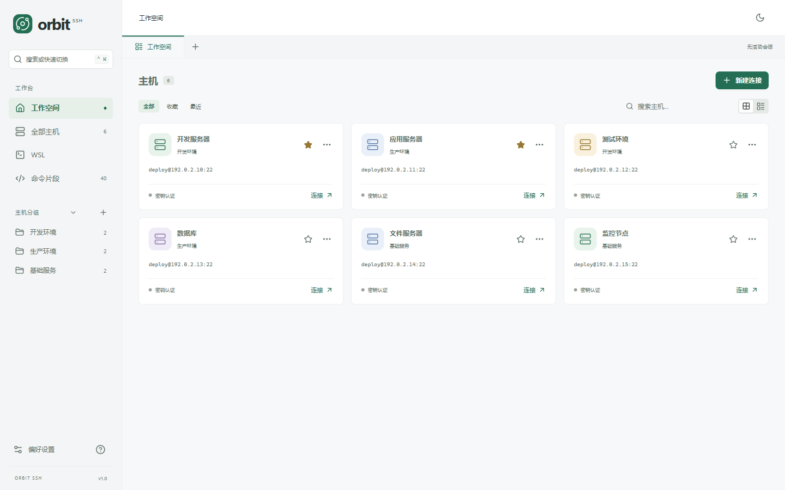
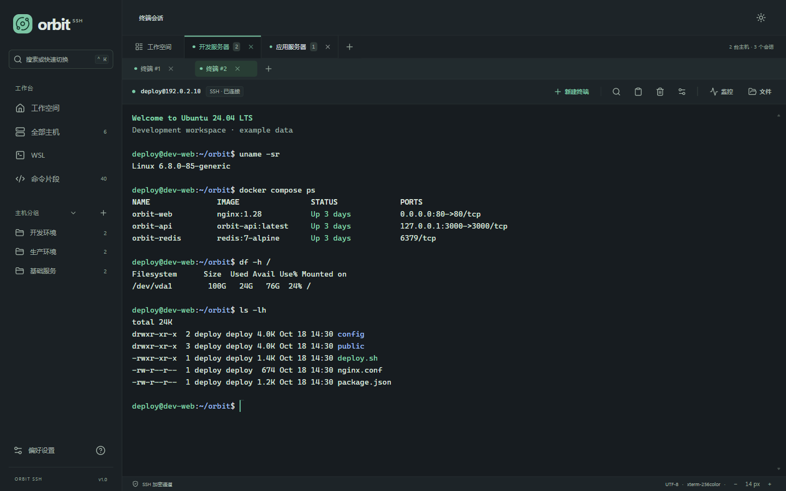
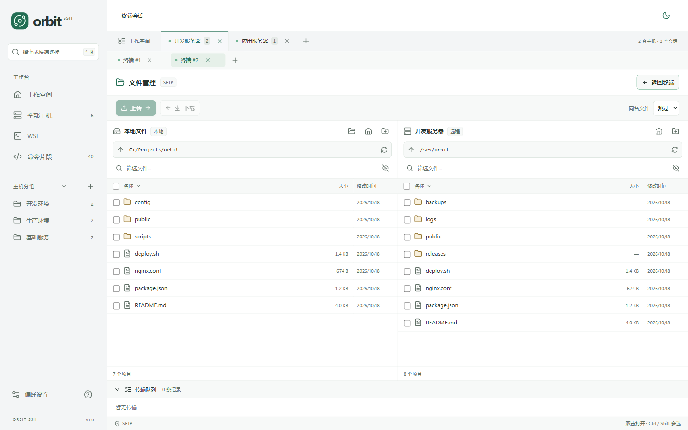
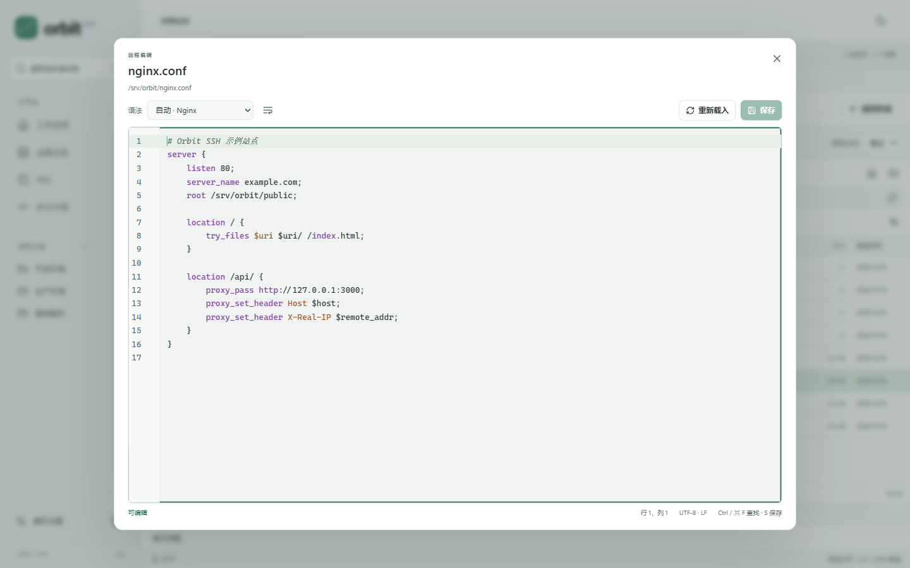

# Orbit SSH

把服务器终端、文件和监控放在同一个窗口。

Orbit SSH 是一款个人 SSH 桌面工具，适合日常连接 Linux 服务器、维护文件，以及在 Windows 上使用本地 Shell 和 WSL。无需注册账号，主机配置和登录凭据保存在本机。

**[下载 v1.0 · Windows x64](https://github.com/xmyhhh/orbit-ssh/releases/download/v1.0/OrbitSSH-v1.0-windows-x64.exe)** · [查看发布说明](https://github.com/xmyhhh/orbit-ssh/releases/tag/v1.0) · [反馈问题](https://github.com/xmyhhh/orbit-ssh/issues)

查看更多界面：多终端、文件管理与远程编辑

### 深色模式与多终端

按主机组织会话，同一主机可同时打开多个独立终端。

### 双栏文件管理

左侧浏览本地文件，右侧浏览服务器目录，支持上传、下载和传输队列。

### 远程文本编辑

直接编辑服务器上的配置文件，支持语法高亮、查找替换和快捷保存。

*截图使用示例主机和数据。*

## 下载与运行

1. 下载 **`OrbitSSH-v1.0-windows-x64.exe`**，保存到你喜欢的文件夹。
2. 双击运行，无需安装 Orbit SSH，也无需安装 Go 或 Node.js。
3. 启动后进入「远程主机」首页，点击「新建连接」添加第一台服务器。

本次发布仅提供 **Windows x64** 可执行文件。需要已安装 Microsoft Edge WebView2 Runtime；Windows 11 通常自带。如果无法启动或提示缺少 WebView2，请从 [微软官方网站](https://developer.microsoft.com/microsoft-edge/webview2/#download) 安装 Evergreen Runtime 后重试。

仓库还提供 **Android 9+ ARM64** 本地构建：运行 `.\android\build.ps1`，生成 `build/bin/OrbitSSH-v1.0.2-android-arm64.apk`。安装与手机端操作见 [Android 说明](docs/ANDROID.md)。

WSL 是可选功能。只有使用 WSL 终端时，才需要另外安装 WSL 和 Linux 发行版。

## 你可以用它做什么

| 功能 | 使用方式 |
| --- | --- |
| 管理服务器 | 按分组整理主机，收藏常用服务器，搜索名称或地址，查看最近连接；卡片和列表视图随时切换并记住选择。 |
| 连接 SSH | 使用密码或 PEM / OpenSSH 私钥登录，可记住密码和私钥口令；首次连接核对服务器指纹。 |
| 同时开多个终端 | 多台主机各自拥有标签，同一主机下可再开多个独立终端，切换时保留会话。 |
| 使用终端 | 搜索输出、复制粘贴、调整字号，右键打开常用操作；多行粘贴前会确认。 |
| 传输文件 | 双栏浏览本地与远程目录，上传、下载文件或整个文件夹，查看进度、速度和失败原因。 |
| 编辑远程文本 | 直接打开配置或代码，使用语法高亮、查找替换、撤销和自动换行，保存到服务器。 |
| 查看服务器状态 | 查看 Linux 服务器的 CPU、内存、交换空间、磁盘和进程，可调整刷新间隔或暂停采样。 |
| 打开 WSL | 自动发现本机已安装的发行版，直接打开交互终端，同一发行版可开多个会话。 |
| 打开本地 Shell | 在窗口中运行 Windows PowerShell、CMD 或已安装的 PowerShell 7，支持多个独立终端。 |
| 常驻后台 | Windows 启动后显示系统托盘图标，默认关闭窗口时保留终端和传输；从托盘菜单恢复窗口或退出应用。 |
| 复用常用命令 | 内置 40 条 Linux 命令片段，支持分类、搜索、自定义和编辑；插入后按 Enter 执行。 |
| 调整外观 | 浅色、深色或跟随系统，在偏好设置中调整终端字号和行距。 |

## 第一次连接服务器

1. 点击「新建连接」，填写主机名称、IP 地址或域名、SSH 端口和用户名。地址不需要加 `ssh://`，默认端口为 `22`。
2. 选择密码或私钥认证。使用私钥时，选择本机的私钥文件；加密私钥会在连接时要求输入口令。
3. 保存后双击主机卡片或点击「连接」。首次连接会显示服务器的 SHA-256 指纹，请与可信来源提供的指纹核对后再确认。
4. 如需下次免输密码，可勾选「记住密码」。只有成功登录后，凭据才会保存到 Windows 凭据管理器。

已经连接的主机再次双击，会新建一个独立终端。也可以在当前主机内点击「新建终端」或标签旁的「＋」。关闭一个终端不会关闭其他终端；关闭主机标签会结束该主机下的全部会话。

## 文件传输与编辑

连接服务器后，点击「文件」打开双栏文件管理器：**左侧是本地，右侧是远程**。

- **上传**：在左侧选择文件或文件夹，切换右侧到目标目录，再点击「上传」。
- **下载**：在右侧选择项目，切换左侧到保存目录，再点击「下载」。
- **同名文件**：默认跳过，可按需要切换为替换。
- **编辑远程文件**：双击远程文本文件，或右键选择「编辑」；修改后按 `Ctrl + S` 保存。本地文本支持只读预览。

传输队列会显示进度、速度和错误，可取消任务。切换终端或主机标签时，传输继续进行；关闭所属连接或退出应用会中断传输。未保存的文本在关闭时会提醒，保存失败会保留当前修改。

远程文本编辑支持不超过 **2 MB 的 UTF-8 文件**，覆盖常见脚本、配置和代码的语法高亮。文件传输需要服务器启用 SFTP；目前不支持断点续传，符号链接和特殊文件会跳过。

## 在窗口中使用本地 Shell

从左侧点击「本地 Shell」，选择 **Windows PowerShell**、**CMD** 或检测到的 **PowerShell 7** 即可打开交互终端，无需添加主机或配置 SSH。安装新的 PowerShell 7 后，可在选择窗口中点击「刷新」重新检测。

终端默认从当前 Windows 用户的主目录启动。点击「新建终端」、会话标签旁的「＋」，或按 `Ctrl + Shift + T`，会打开相同 Shell 的独立会话。输入 `exit` 结束当前终端后，可点击「重新打开」。关闭一个终端不会影响其他会话。

本地 Shell 需要 Windows 10 1809 或更新版本，支持中文输入输出、复制粘贴、输出搜索和字号调整。文件管理与服务器监控用于 SSH 连接。

## 在窗口中使用 WSL

从左侧打开 WSL，选择已安装的发行版即可进入终端，无需为发行版配置 SSH 服务或密码。

如果列表为空，请先在 PowerShell 中运行 `wsl --install`，按照系统提示安装发行版，再回到应用刷新。WSL 内嵌终端需要 Windows 10 1809 或更新版本，以及可正常运行的 WSL 环境。

每个 WSL 终端独立运行，关闭标签只结束当前会话，不会关闭整个发行版。v1.0 中，WSL 提供终端功能；文件管理和服务器监控用于 SSH 连接。

## 关闭窗口与后台常驻

Windows 版启动后会在系统托盘显示 Orbit SSH 图标，图标可能收纳在任务栏右侧的「^」中。默认点击窗口关闭按钮或按 `Alt + F4` 时，窗口会隐藏到托盘，SSH、本地 Shell、WSL 会话和文件传输继续运行，未保存的编辑内容也会保留。

点击托盘图标即可恢复窗口；右键菜单提供「打开 Orbit SSH」「隐藏到托盘」和「退出 Orbit SSH」。要完全退出，请选择托盘菜单中的「退出 Orbit SSH」；存在活动会话或未保存文件时，仍会按原有设置确认，取消后可以继续使用。

如果希望关闭窗口时直接退出，在「偏好设置」中关闭「关闭窗口后常驻后台」。退出应用会结束会话和传输；此设置会保存在本机。后台常驻目前用于 Windows 版。

## 常用快捷键

以下快捷键适用于 Windows。终端相关操作需要先激活终端。

| 快捷键 | 操作 |
| --- | --- |
| `Ctrl + K` | 搜索或快速切换主机 |
| `Ctrl + T` | 新建主机连接 |
| `Ctrl + Shift + T` | 为当前主机、本地 Shell 或 WSL 发行版新建终端 |
| `Ctrl + Shift + F` | 搜索终端输出 |
| `Ctrl + C` | 有选中文本时复制；无选中时向终端发送中断 |
| `Ctrl + V` | 粘贴剪贴板内容，多行文本会先确认 |
| `Ctrl + Shift + C` / `Ctrl + Shift + V` | 复制 / 粘贴 |
| `Ctrl + Shift + A` | 全选终端文本 |
| `Ctrl + +` / `Ctrl + -` | 放大 / 缩小终端字号 |
| `Ctrl + 0` | 恢复偏好设置中的字号 |
| `Ctrl + 滚轮` | 调整终端字号 |
| `Ctrl + S` | 保存正在编辑的远程文本 |
| `Shift + F10` | 打开终端或文件的上下文菜单 |

终端右键菜单还提供复制全部、查找和清屏操作。

## 配置与凭据保存在哪里

Orbit SSH 无需账号，不提供云同步或联网激活。SSH / SFTP 连接直接访问你添加的服务器。

- **主机与偏好设置**：保存在 `%APPDATA%\OrbitSSH\workspace.json`，包含主机信息、分组、命令片段、主题和已信任的服务器指纹。
- **密码与私钥口令**：保存在 Windows 凭据管理器，不写入配置 JSON。系统凭据库不可用时会提示，不会改为明文保存。
- **私钥**：保留在你选择的原始文件位置，配置中仅记录路径。

备份时，请先退出应用，再复制配置文件。配置备份包含服务器地址、用户名和自定义命令，请妥善保管。密码和私钥口令不会随该文件迁移，私钥也需要单独备份。

更新版本时，退出旧版后运行新版即可沿用本机配置；建议更新前备份。删除可执行文件不会同时清除配置或系统中保存的凭据。如需清除已保存的密码或私钥口令，可在主机编辑窗口操作。

## 常见问题

### 连接失败怎么办？

核对服务器地址、端口、用户名和认证方式，确认服务器已启用 SSH，且当前网络和防火墙允许访问该端口。私钥认证还需要确认选择的是私钥文件，服务器已配置对应公钥。

### 为什么提示服务器指纹变化？

应用保存的指纹与服务器当前指纹不一致时，会拒绝连接。重装服务器或更换 SSH 主机密钥可能导致变化，也可能是连接到了不同的机器。请先通过可信渠道核实原因和新指纹，不要直接忽略提示。反馈问题时无需提供密码或私钥。

### 为什么文件无法上传或保存？

先确认服务器已启用 SFTP，并且当前用户对目标目录有写入和重命名权限。远程编辑通过临时文件写入后替换原文件，因此仅有原文件的写权限可能不够；目前不提供 sudo 保存。

远程编辑会检测文件变化，但仍建议避免多个程序同时修改同一文件。替换保存不复制原文件的 ACL、扩展属性及硬链接关系，编辑带有特殊元数据的文件前请自行备份。

### 为什么监控没有数据？

监控目前面向 Linux 服务器，需要 `/proc`、`df` 和 procps 提供的 `ps` 命令。CPU 使用率会在第二次采样后显示；进程 CPU 是 `ps` 报告的生命周期平均值，多核时可能超过 100%。监控不需要在服务器安装 Orbit SSH 专用程序，窗口隐藏时会暂停采样。

### v1.0 有 macOS、Linux 或 ARM64 下载吗？

本次 Release 只提供 Windows x64 可执行文件。源码基于 Wails、Go 和 React，其他平台需要在相应系统自行构建和验证，参见[开发与构建说明](docs/DEVELOPMENT.md)。

## 反馈问题

欢迎在 [Issues](https://github.com/xmyhhh/orbit-ssh/issues) 中提交问题或建议。请附上应用版本、Windows 版本、操作步骤和错误提示；如涉及服务器功能，也请说明服务器系统。截图和日志中的服务器地址、用户名等信息可先打码，请勿上传密码、私钥或完整的本机配置文件。
